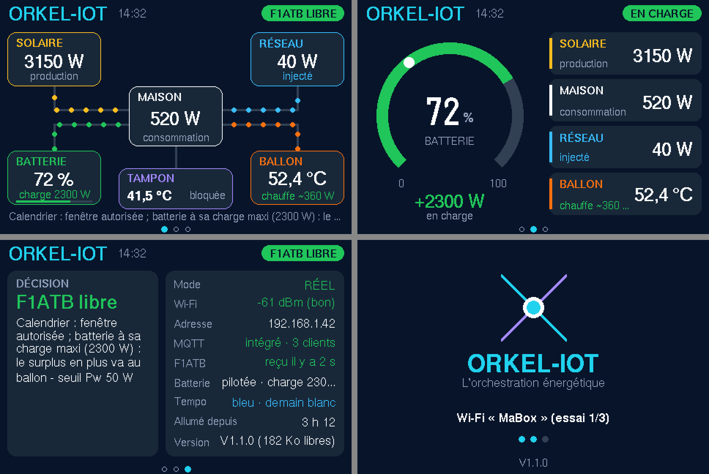
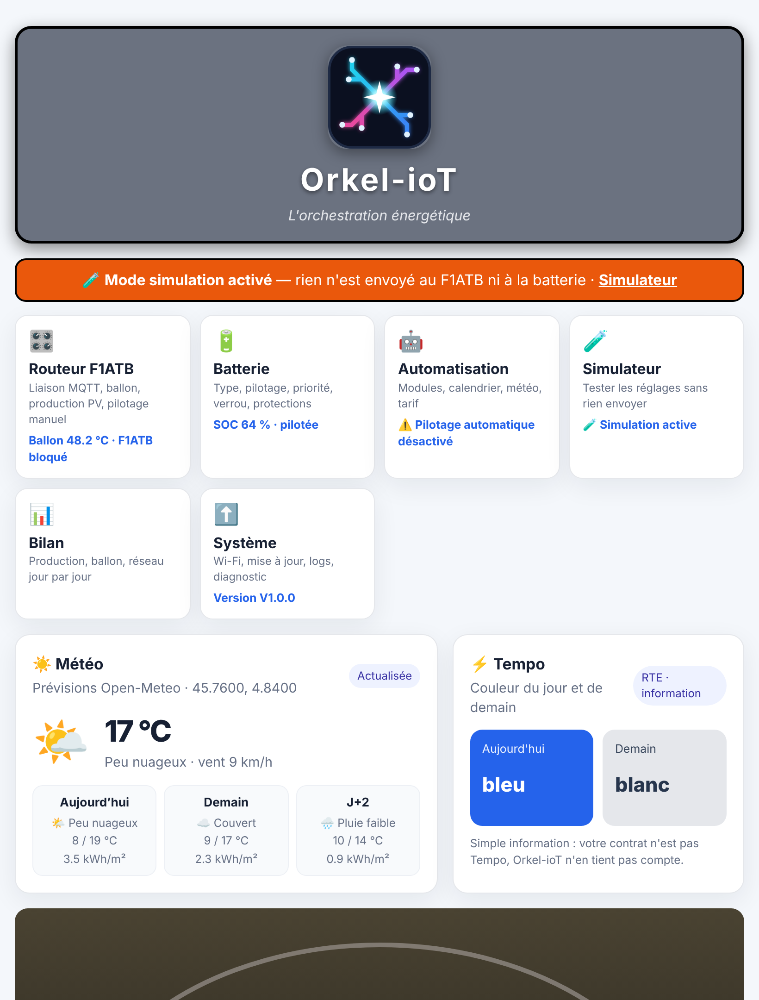

**Orkel-ioT** est un module ESP32 qui pilote le routeur solaire **F1ATB** (ballon d'eau chaude) en tenant compte de la
**batterie** (Zendure, Izypower, autre marque ou aucune), de la **production photovoltaïque**, de la **météo**, du
**tarif** (Base, heures creuses, Tempo) et de vos **règles** (calendrier, températures, anti-légionelle, vacances…).
Il fonctionne seul, sans domotique, et sait aussi s'intégrer à une domotique par MQTT.

- Orkel-ioT s'appelait auparavant **Orkelys** (même programme, nouveau nom ; numérotation repartie à V1.0.0).
- Pour le moment, Orkel-ioT est un projet en développement. Il est utilisé avec un SolarFlow 2400 AC+ Zendure et une Izypower en test.
- Il sert à optimiser l'usage d'une batterie par rapport au routeur F1ATB, pour ceux qui n'ont pas de domotique.
- Il envoie ses informations à l'[afficheur-routeur](https://github.com/loustic03/Afficheur-routeur) (avec un écran « déporté Orkel-ioT » à poser à côté de la batterie).
- **Avec ou sans F1ATB** : sans routeur, Orkel-ioT pilote seulement la batterie, avec le compteur lu sur un Shelly EM / Pro 3EM, par MQTT ou sur le cloud Izypower.
- **Calendrier de la batterie** : créneaux « veille », « décharge seulement » (fini le va-et-vient charge / décharge aux heures des repas) et « SOC mini ».
- Batteries : **Zendure** (locale, pilotée), **Marstek Venus** (câble RS485, lecture), **Izypower** (cloud, pilotée), autre marque (MQTT / HTTP) ou aucune.
  - **Zendure** : pilotée par son API locale officielle (zenSDK). Modèles compatibles avec l'API locale (d'après les intégrations zenSDK existantes) :
    - SolarFlow 2400 AC, 2400 AC+ et 2400 AC Pro ;
    - SolarFlow 1600 AC+ ;
    - SolarFlow 800, 800 Pro et 800 Plus ;
    - SolarFlow 3000 Mix AC+ ;
    - SolarFlow 4000 Mix (AC+ ou Pro).

    Testé en réel sur la SolarFlow 2400 AC+. Régler « Charge maxi » et « Décharge maxi » selon le modèle (ex. 800 W pour une 800 Pro). Les anciens modèles sans API locale (Hyper 2000, Hub 1200 / 2000) ne sont pas pilotables. Une seule batterie Zendure à la fois.
- **Telegram** : état, bilan de la veille, marche forcée / arrêt du ballon et alertes de panne sur le téléphone, sans rien ouvrir dans la box ([guide](Orkel-ioT_guide_Telegram.pdf)).
- Une page **💶 Tarifs & économies** : prix du kWh (Base, heures pleines / creuses, Tempo), heures creuses données par les plages horaires, le compteur Linky (lu par le F1ATB) ou la domotique, et le bilan en euros de chaque jour : dépense sur le réseau, gain du solaire, gain de la batterie.
- Un **rapport du mois** clair (A4, à imprimer ou enregistrer en PDF) résume production, consommation, ballon, réseau et batterie ; sur la JC3248W535, une carte microSD garde toutes les journées et un rapport par mois.
- Un **simulateur** fonctionne sur les mesures réelles, pour tester les réglages sans rien commander.
- **Écran intégré** (V1.1.0) : sur la carte **JC3248W535** (ESP32-S3, écran 3,5" tactile), Orkel-ioT affiche lui-même un **tableau de bord** (production, consommation, économies, batterie), le **flux**, la **batterie** et son **état** — un seul boîtier, sans afficheur séparé. Installer la version **« JC3248W535 »** (choix dans la page d'installation).

Version actuelle : **V1.7.8** · Auteur : [loustic03](https://github.com/loustic03) (je suis aussi l'auteur de l'afficheur F1ATB) — voir [CHANGELOG.md](CHANGELOG.md).

## 📖 Guide

- Installer et mettre à jour le programme (fichiers .bin), pas à pas : [Orkel-ioT_installer_mettre_a_jour.pdf](Orkel-ioT_installer_mettre_a_jour.pdf)
- Batterie Izypower et ballon d'eau chaude, pas à pas : [Orkel-ioT_guide_Izypower_ballon.pdf](Orkel-ioT_guide_Izypower_ballon.pdf)

Tout le paramétrage, page par page : **[Orkel-ioT_guide_parametrage.pdf](Orkel-ioT_guide_parametrage.pdf)**

## ⚡ Installer (première fois)

### Le plus simple : depuis le navigateur
Ouvrir la **page d'installation** (Chrome ou Edge sur ordinateur), brancher l'ESP32 en USB, cliquer sur « Installer » :
👉 **https://loustic03.github.io/Orkel-ioT/**

### Ou avec le fichier .bin
Dans le dossier [`bin`](bin), prendre le fichier de **votre carte** et l'écrire à l'adresse **0x0** avec
https://espressif.github.io/esptool-js/ :

| Carte | Fichier |
|---|---|
| ESP32 classique (4 Mo) | `Orkel-ioT_ESP32-classique_4Mo.bin` |
| ESP32-S3 N8R8 / N16R8 (avec PSRAM) | `Orkel-ioT_ESP32-S3_8Mo-PSRAM.bin` |
| JC3248W535 (ESP32-S3 avec écran 3,5") | `Orkel-ioT_JC3248W535.bin` |

### 🔑 Clé de licence
Orkel-ioT demande une **clé de licence par module**. Sans clé, il fonctionne en **mode démo** (rien n'est envoyé au F1ATB
ni à la batterie). Page **Système → 🔑 Licence** : **Demander ma clé** (e-mail tout prêt vers **thierry260sg@gmail.com**, par Gmail, la messagerie de l'appareil ou en copiant le texte), puis coller la clé reçue et **Activer**.
Pour soutenir le projet : [☕ faire un don (PayPal)](https://www.paypal.com/donate?hosted_button_id=CJVFHE57YBM8L).

### Premier démarrage
1. Se connecter au Wi-Fi **Orkel-ioT-Setup**, ouvrir **http://192.168.4.1/**.
2. Page **Système → Wi-Fi** : nom et mot de passe de la box (2,4 GHz), **Enregistrer**. Orkel-ioT affiche sa nouvelle adresse.
3. Rebrancher le téléphone sur la box et ouvrir cette adresse (ou **http://orkel-iot.local/**).
4. Le module neuf démarre en **mode simulation** (bandeau orange) : il ne commande rien tant que vous ne l'avez pas
   désactivé. Suivre le guide.

## 🔄 Mettre à jour (sans câble)

**Le plus simple :** page **Système** d'Orkel-ioT → cadre « 🌐 Mise à jour depuis GitHub » →
**Vérifier maintenant**, puis **Installer la nouvelle version** (avec le mot de passe de mise à jour). Orkel-ioT télécharge
lui-même le bon fichier et redémarre. Il n'installe jamais rien sans toi.

**Ou avec le fichier :** Les fichiers de mise à jour sont dans les **[Releases](https://github.com/loustic03/Orkel-ioT/releases)** (une par version)
et dans le dossier [`bin`](bin) (dernière version). Page **Système → Mise à jour du firmware** d'Orkel-ioT : envoyer le
fichier **`OTA_…_Orkel-ioT.ino.bin`** indiqué dans le cadre vert (jamais le gros fichier de première installation).
Les réglages sont conservés.

| Carte | Fichier de mise à jour |
|---|---|
| ESP32 classique | `OTA_ESP32-classique_Orkel-ioT.ino.bin` |
| ESP32-S3 N8R8 / N16R8 (avec PSRAM) | `OTA_ESP32-S3_8Mo_Orkel-ioT.ino.bin` |
| JC3248W535 (avec écran) | `OTA_JC3248W535_Orkel-ioT.ino.bin` |

## ⚠️ Sécurité

Orkel-ioT commande le F1ATB par des forçages temporaires : s'il s'arrête, le F1ATB reprend seul son fonctionnement
normal au bout de 60 minutes au plus. Une sécurité de température (80 °C d'origine) coupe toute chauffe.
Utilisation sous votre responsabilité ; les installations électriques doivent rester conformes.

## © Licence

© 2026 Orkel-ioT — tous droits réservés. Voir [LICENCE](LICENCE).

---

### Crédits
Registres Modbus de la Marstek Venus : projet [marstek-lilygo-rs485](https://github.com/whyisthisbroken/marstek-lilygo-rs485) (licence MIT, © 2025 whyisthisbroken).

---

